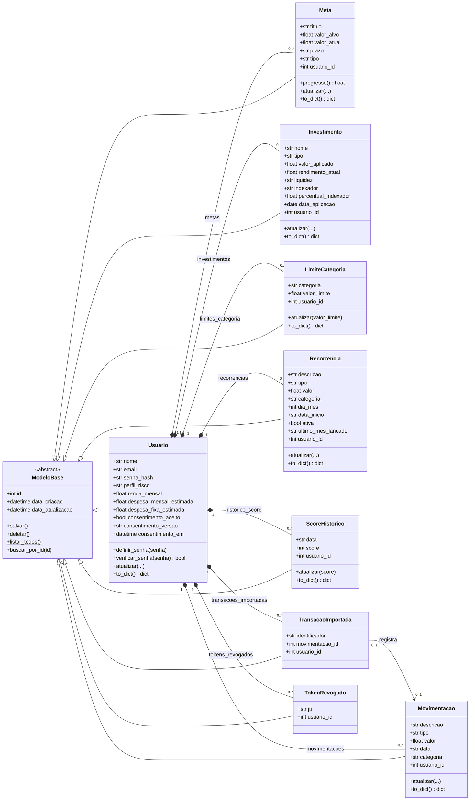

# Diagrama de classes do domínio

Classes das Models do backend (`backend/models/`) e seus relacionamentos. O GitHub
desenha o diagrama abaixo automaticamente; a mesma figura está em
[diagrama_de_classes.png](diagrama_de_classes.png).

## Como ler

- **Herança.** Todas as Models herdam de `ModeloBase`, uma classe abstrata
  (`__abstract__ = True`) que herda de `db.Model`. Ela traz os campos comuns (`id`,
  `data_criacao`, `data_atualizacao`) e o CRUD básico: `salvar()`, `deletar()`,
  `listar_todos()` e `buscar_por_id()`. Cada Model que pode ser alterada implementa
  seu próprio `atualizar(...)`, porque os campos aceitos mudam de uma entidade para
  outra. `TransacaoImportada` e `TokenRevogado` são registros que só são criados e
  apagados, por isso não têm `atualizar`.
- **Composição (losango cheio).** `Usuario` é dono de todas as outras entidades: elas
  só existem ligadas a um usuário (`usuario_id` obrigatório) e são apagadas junto com
  ele (`cascade="all, delete-orphan"` em `models/usuario.py`), como acontece em
  "Excluir conta".
- **Associação (seta).** `TransacaoImportada` aponta para a `Movimentacao` que nasceu
  daquela linha do extrato. Uma não é dona da outra: quando o usuário exclui a
  movimentação, a marcação é removida e a linha pode ser importada de novo
  (`TransacaoImportadaRepository.liberar_da_movimentacao`). O projeto não tem
  agregação.

## Regras representadas por atributos

| Classe | Atributo | Valores |
|---|---|---|
| `Usuario` | `perfil_risco` | `conservador`, `moderado`, `arrojado` (RF18) |
| `Movimentacao`, `Recorrencia` | `tipo` | `renda` ou `gasto` |
| `Meta` | `tipo` | `geral` ou `reserva_emergencia` (RF14/RF15) |
| `LimiteCategoria` | (`usuario_id`, `categoria`) | único por usuário |
| `ScoreHistorico` | (`usuario_id`, `data`) | um registro por dia |
| `TransacaoImportada` | (`usuario_id`, `identificador`) | evita importar a mesma linha duas vezes |

`Recorrencia`, `ScoreHistorico` e `TransacaoImportada` foram acrescentadas depois do
DER do relatório de elicitação.
