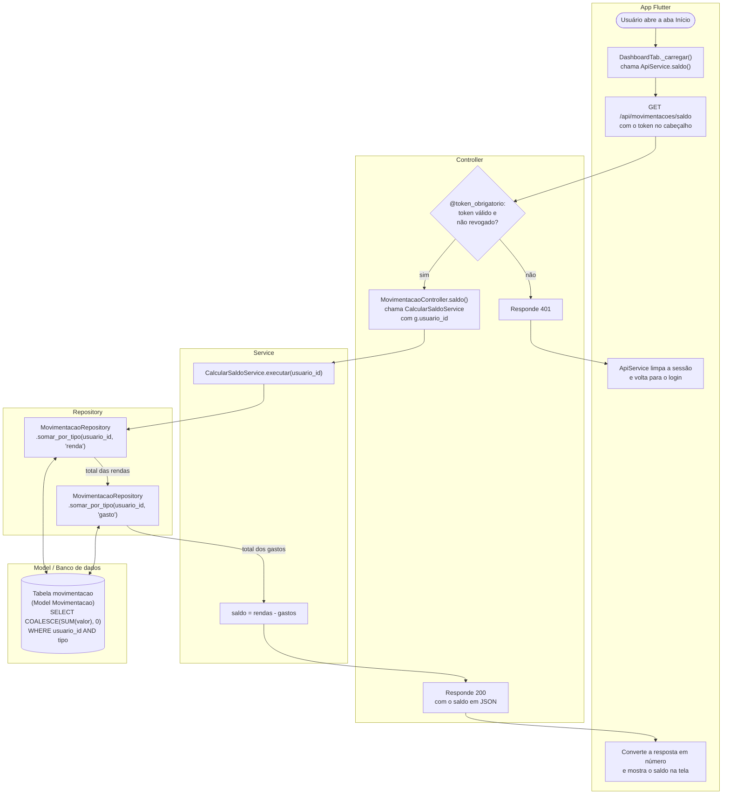
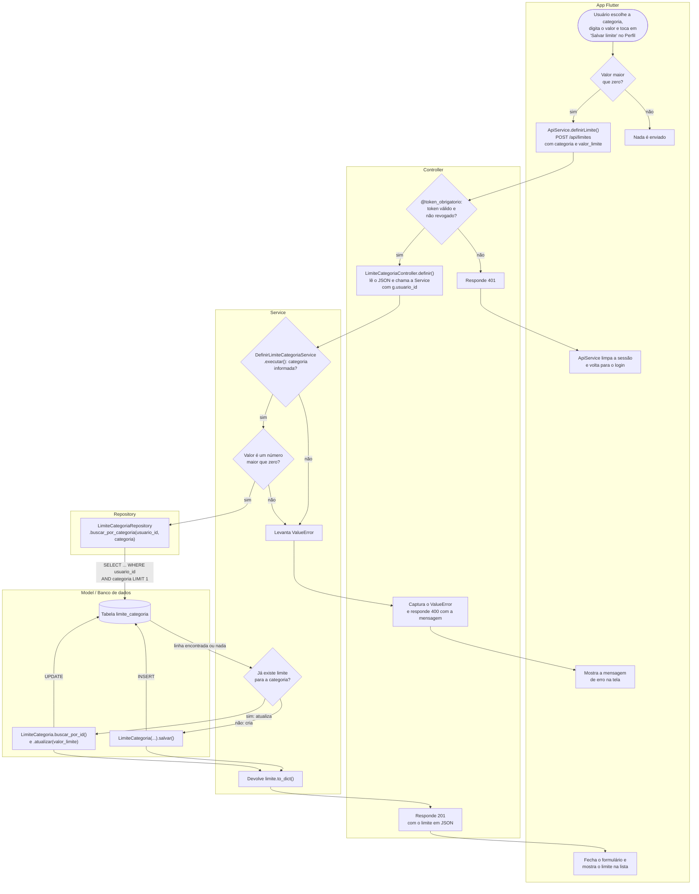

# Fluxogramas dos casos de uso

Dois casos de uso acompanhados pelas camadas do sistema, do toque na tela até o banco de
dados e de volta. O GitHub desenha os diagramas abaixo automaticamente; as mesmas
figuras, para usar nos slides, estão em
[fluxograma_consultar_saldo.png](fluxograma_consultar_saldo.png) e
[fluxograma_definir_limite.png](fluxograma_definir_limite.png).

| Fluxograma | Caso de uso | Tipo |
|---|---|---|
| [1](#1-consultar-o-saldo-rf05) | Consultar o saldo (RF05) | Recuperação de dados |
| [2](#2-definir-o-limite-de-uma-categoria-rf13) | Definir o limite de gasto de uma categoria (RF13) | Entrada de dados |

Antes de chegar à Controller, toda rota de dados passa pelo decorator
`@token_obrigatorio` ([auth_decorators.py](../backend/controllers/auth_decorators.py)).
Ele confere o token, busca o `usuario_id` dentro dele e consulta o
`TokenRevogadoRepository` para recusar tokens de quem já fez logout. Por isso a
verificação aparece nos dois fluxogramas.

---

## 1. Consultar o saldo (RF05)

O usuário abre a aba Início e o app mostra o saldo. O saldo não fica guardado: a cada
pedido, o Repository soma as rendas e os gastos com SQL e a Service subtrai.

| Camada | Arquivo |
|---|---|
| App | `frontend_flutter/lib/screens/dashboard_tab.dart`, `lib/services/api_service.dart` |
| Controller | `backend/controllers/movimentacao_controller.py` (método `saldo`) |
| Service | `backend/services/movimentacao/calcular_saldo_service.py` |
| Repository | `backend/repositories/movimentacao_repository.py` (método `somar_por_tipo`) |
| Model | `backend/models/movimentacao.py` |

---

## 2. Definir o limite de uma categoria (RF13)

No Perfil, o usuário escolhe uma categoria e digita o limite mensal. Só pode existir um
limite por categoria: se já houver, ele é atualizado; se não, é criado. Quem descobre
qual dos dois é o Repository, e quem grava é a Model.

| Camada | Arquivo |
|---|---|
| App | `frontend_flutter/lib/screens/perfil_tab.dart`, `lib/services/api_service.dart` |
| Controller | `backend/controllers/limite_categoria_controller.py` (método `definir`) |
| Service | `backend/services/limite_categoria/definir_limite_categoria_service.py` |
| Repository | `backend/repositories/limite_categoria_repository.py` (método `buscar_por_categoria`) |
| Model | `backend/models/limite_categoria.py` (`atualizar`) e `backend/models/base.py` (`salvar`) |

### O que mostrar com este fluxograma

- **A divisão de trabalho entre as camadas.** O Repository só consulta, com SQL. A
  Service decide entre criar e atualizar. A Model grava, pelo ORM.
- **O caminho do erro.** A Service levanta `ValueError`, a Controller transforma em
  resposta 400 e o app mostra a mensagem. É a mesma convenção do projeto inteiro.
